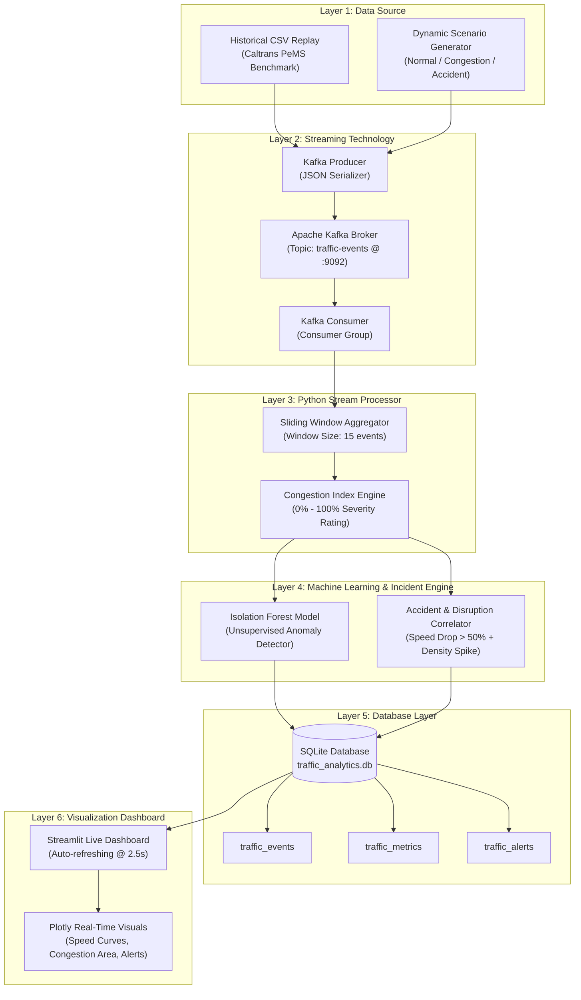

# Real-Time Traffic Congestion and Accident Detection System Using Apache Kafka and Machine Learning

[](https://www.python.org/)
[](https://kafka.apache.org/)
[](https://scikit-learn.org/)
[](https://streamlit.io/)
[](https://www.sqlite.org/)

An end-to-end, locally executable mini-project for the **Data Stream Analytics** course. The platform ingests, processes, analyzes, and visualizes real-time continuous traffic observations across multiple arterial road segments, dynamically identifying congestion buildup, statistical speed anomalies, and accident disruptions.

---

## 1. Project Introduction & Problem Statement

Urban road networks suffer from sudden traffic jams, bottlenecks, and unexpected collisions. Conventional traffic surveillance depends on batch processing, periodic reporting, or manual dispatch, which delays emergency response and commuter advisories.

**The Solution:**
This system implements a real-time event-driven data streaming pipeline capable of:
1. Replaying and generating realistic multi-sensor road traffic streams without physical IoT or camera hardware dependencies.
2. Buffering and distributing JSON traffic payloads at low latency using **Apache Kafka**.
3. Performing real-time sliding-window analytics (rolling speed, density, occupancy, congestion indices) using a dedicated **Python Stream Processor**.
4. Detecting multi-variate statistical traffic anomalies in real time using an unsupervised **Isolation Forest** machine learning model.
5. Correlating sudden physical collapses with simulated incident markers to trigger prioritized **Accident and Congestion Alerts**.
6. Storing analytical states and logs into an **SQLite** analytical database.
7. Presenting live indicators on an auto-refreshing **Streamlit Live Operations Dashboard**.

---

## 2. Six-Layer Architecture



---

## 3. Monitored Road Segments & Key Parameters

| Segment Name | Highway Type | Free-Flow Speed | Capacity (veh/interval) | Jam Density (veh/km) |
| :--- | :--- | :--- | :--- | :--- |
| `Highway-101-North` | Express Corridor | 90 km/h | 150 | 180 |
| `Highway-101-South` | Express Corridor | 90 km/h | 150 | 180 |
| `Interstate-80-East` | Major Interstate | 90 km/h | 150 | 180 |
| `Interstate-80-West` | Major Interstate | 90 km/h | 150 | 180 |
| `Downtown-Expressway` | Urban Arterial | 80 km/h | 120 | 180 |

### Congestion Index Formulation
$$\text{Congestion Index (CI)} = \max\left(0, \min\left(100, \left(1.0 - \frac{v_{\text{rolling}}}{v_{\text{free\_flow}}}\right) \times 100\right)\right)$$

- **Low Traffic:** $0\% \le \text{CI} < 30\%$
- **Moderate Traffic:** $30\% \le \text{CI} < 60\%$
- **Heavy Traffic:** $60\% \le \text{CI} < 80\%$
- **Severe Congestion:** $80\% \le \text{CI} \le 100\%$

---

## 4. Machine Learning & Anomaly Detection

- **Algorithm:** Scikit-Learn `IsolationForest`
- **Features Analyzed:**
  - `average_speed`: Current mean vehicle speed (km/h)
  - `vehicle_count`: Total vehicles observed in sample
  - `traffic_density`: Vehicles per kilometer (veh/km)
  - `road_occupancy`: Percentage of lane occupation ($0-100\%$)
  - `speed_ratio`: Current speed normalized against free-flow speed ($v / v_{\text{ff}}$)
- **Model Output:**
  - `Decision Function Score`: Normalized float (lower/negative values signify increasing statistical abnormality).
  - `Normal Traffic`: Score $\ge 0.0$
  - `Unusual Traffic Pattern`: $-0.08 \le \text{Score} < 0.0$
  - `Severe Traffic Anomaly`: $\text{Score} < -0.08$

> **Academic Note on Accident Detection:**
> Machine learning (Isolation Forest) detects **unusual statistical behavior**, not verified accidents. The system correlates statistical anomalies with verified incident tags (`SIMULATED_ACCIDENT`, `HISTORICAL_INCIDENT`) or sudden physical road collapses ($>50\%$ speed drop within 3 events) to trigger **Accident Alerts**.

---

## 5. Project Directory Structure

```
Real_Time_Traffic_Congestion/
│
├── config/
│   └── settings.py               # Central configurations (Kafka, DB, ML, thresholds)
│
├── data/
│   ├── raw/
│   │   ├── traffic_historical_data.csv    # 2,500 historical highway records
│   │   └── generate_historical_dataset.py # Historical dataset generator
│   └── processed/
│
├── database/
│   ├── traffic_analytics.db      # SQLite database (events, metrics, alerts)
│   ├── db_setup.py               # Table creation & index definitions
│   └── db_operations.py          # CRUD queries, WAL mode, KPI aggregations
│
├── ml/
│   ├── train_model.py            # Isolation Forest training script
│   └── predict.py                # Online scoring & anomaly classifier
│
├── models/
│   └── isolation_forest.pkl      # Pre-trained model artifact
│
├── producer/
│   └── traffic_producer.py       # Kafka streaming producer (CSV / Scenario)
│
├── processor/
│   └── traffic_processor.py      # Kafka stream processor, windowing & ML
│
├── simulation/
│   ├── scenario_generator.py     # Modes 1, 2, 3 generator
│   └── active_scenario.json      # Dynamic scenario state
│
├── dashboard/
│   └── app.py                    # Streamlit Operations Center UI
│
├── scripts/
│   ├── create_topic.py           # Kafka topic initializer
│   ├── start_kafka.ps1           # Launches Zookeeper & Kafka Broker
│   ├── start_producer.ps1        # Launches Producer
│   ├── start_processor.ps1       # Launches Stream Processor
│   ├── start_dashboard.ps1       # Launches Streamlit UI
│   └── stop_all.ps1              # Clean process termination
│
├── tests/
│   ├── test_database.py          # Database unit tests
│   ├── test_ml.py                # Isolation Forest tests
│   ├── test_processor.py         # Windowing & alert tests
│   └── test_producer.py          # Scenario generation tests
│
├── run_pipeline.ps1              # Master one-click startup script
├── requirements.txt              # Project Python dependencies
├── README.md                     # Technical documentation
└── PROJECT_REPORT.md             # Academic project report
```

---

## 6. Installation & Execution Guide

### Prerequisites
- **Operating System:** Windows 10/11 (PowerShell)
- **Java:** OpenJDK 17 or Java 11+ installed and on PATH
- **Python:** Python 3.11.x installed
- **Apache Kafka:** Kafka 3.x installed (e.g., at `C:\kafka`)

### Step 1: Clone / Navigate to Workspace
```powershell
cd c:\Users\Dell\Downloads\Real_Time_Traffic_Congestion
```

### Step 2: Initialize Virtual Environment
```powershell
& "C:\Users\Dell\AppData\Local\Programs\Python\Python311\python.exe" -m venv .venv
.\.venv\Scripts\Activate.ps1
python -m pip install -r requirements.txt
```

### Step 3: Train the Machine Learning Model
```powershell
python ml/train_model.py
```

### Step 4: Run the Complete Master Pipeline
Launch all 6 layers using the master PowerShell script:
```powershell
.\run_pipeline.ps1
```
This script automatically:
1. Validates the environment.
2. Initializes SQLite tables.
3. Checks and launches Zookeeper (`2181`) and Kafka Broker (`9092`).
4. Creates the `traffic-events` topic.
5. Launches the **Stream Processor** in a separate terminal.
6. Launches the **Traffic Producer** in a separate terminal.
7. Launches the **Streamlit Dashboard** at `http://localhost:8501`.

---

## 7. Interactive Demonstration Modes


The system supports 3 dynamic demonstration modes switchable via the **Streamlit Sidebar Dropdown**:

1. **Mode 1: Normal Traffic (`NORMAL_TRAFFIC`)**
   - Natural fluid traffic flow ($75-95\text{ km/h}$).
   - Low occupancy and density; clean green status.
2. **Mode 2: Traffic Congestion (`TRAFFIC_CONGESTION`)**
   - Progressive traffic deceleration ($85\text{ km/h} \to 25\text{ km/h}$).
   - Surge in vehicle density and road occupancy; triggers Moderate and Heavy congestion levels.
3. **Mode 3: Accident Scenario (`ACCIDENT_SCENARIO`)**
   - Injects a severe localized collision on the selected roadway (e.g., `Highway-101-North`).
   - Sudden collapse in speed ($<15\text{ km/h}$) and gridlock density ($>120\text{ veh/km}$).
   - Instantly triggers a **CRITICAL Incident Alert** (`SIMULATED_ACCIDENT_DETECTED`) and ML anomaly flagging.

---

## 8. Automated Testing

Run the automated test suite using pytest:
```powershell
.\.venv\Scripts\python.exe -m pytest tests/ -v
```
**Test Coverage:**
- SQLite database transactions, metrics insertion, and duplicate prevention.
- Machine Learning Isolation Forest prediction range and outlier classification.
- Sliding-window rolling speed and Congestion Index formulas.
- Event generation across Normal, Congestion, and Accident modes.

---

## 9. Troubleshooting

- **Kafka Broker Offline (`localhost:9092`):**
  Ensure Zookeeper is started first (`C:\kafka\bin\windows\zookeeper-server-start.bat C:\kafka\config\zookeeper.properties`), then start Kafka broker (`C:\kafka\bin\windows\kafka-server-start.bat C:\kafka\config\server.properties`).
- **Port Conflicts:**
  If port `9092` or `2181` is occupied, run `.\scripts\stop_all.ps1` to terminate dangling processes.
- **SQLite Database Locked:**
  WAL mode is enabled by default in `database/db_setup.py` to allow concurrent stream writes and dashboard reads without lock contention.
